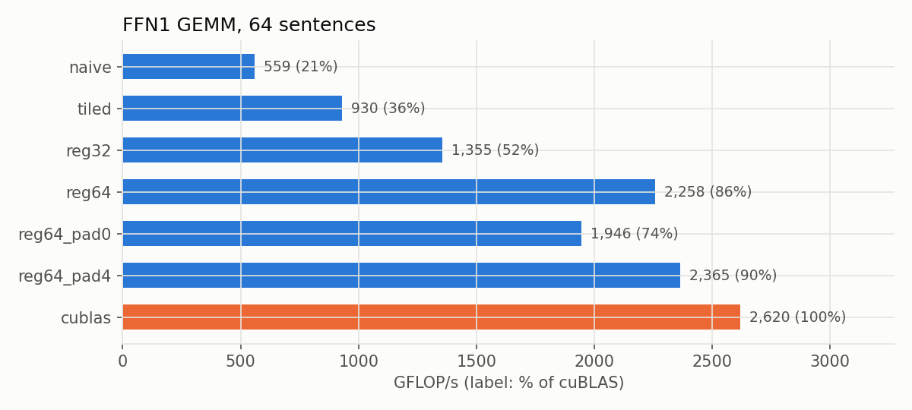
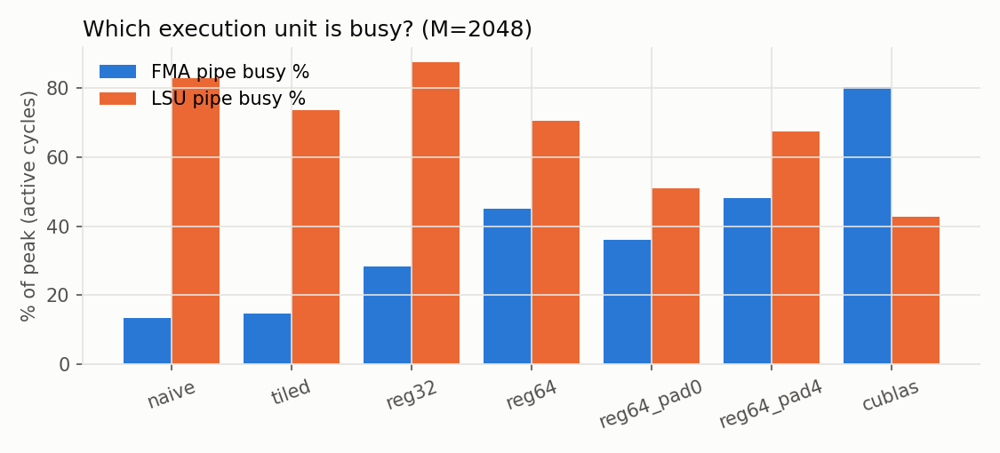
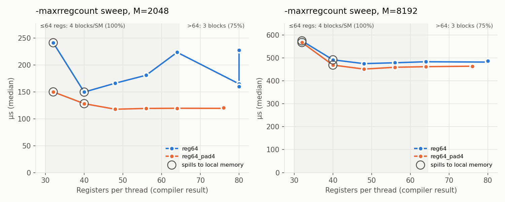
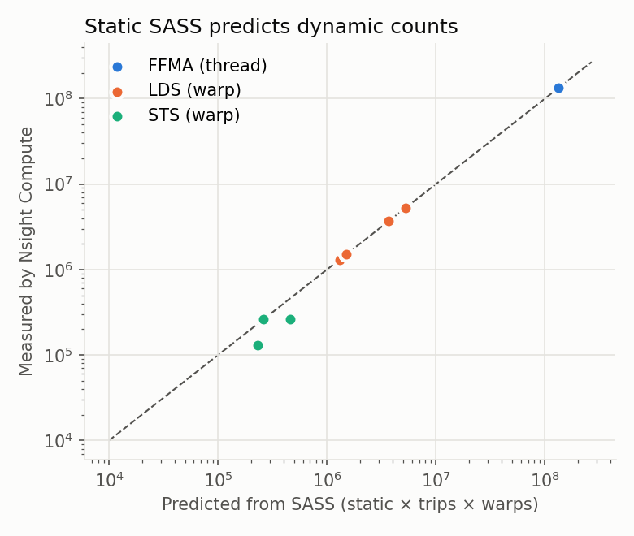
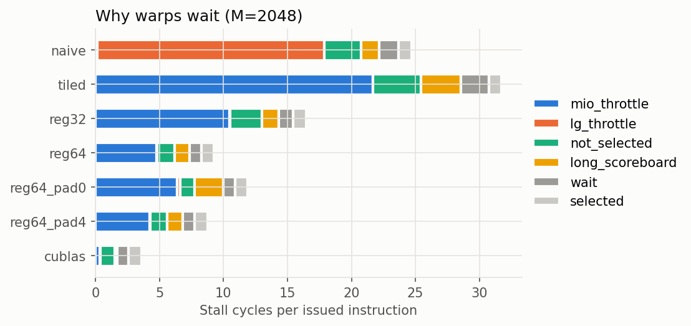

# perf/ results (generated by perf/analyze.py)

```
name, compute_cap, driver_version, clocks.max.sm [MHz], power.limit [W]
Tesla T4, 7.5, 580.82.07, 1590 MHz, 70.00 W
Cuda compilation tools, release 13.0, V13.0.88
Build cuda_13.0.r13.0/compiler.36424714_0
Version 2025.3.1.0 (build 36398880) (public-release)
```

## 1. Compiler output and runtime, FFN1 at 64 sentences (M=2048, N=512, K=128)

Loop columns are per main-loop trip (one k-tile) per thread, read from SASS.

| kernel | regs | local_bytes | static_smem | blocks | blocks_per_sm | occupancy_pct | waves | us_median | cv_pct | gflops | pct_cublas | loop_ffma | loop_lds | loop_lds128 | loop_sts | loop_ffma_per_lds | max_rel_err |
|---|---|---|---|---|---|---|---|---|---|---|---|---|---|---|---|---|---|
| naive | 50 | 0 | 0 | 4096 | 4 | 100 | 25.6 | 480 | 10.7 | 559 | 21.4 | 16 | 0 | 0 | 0 |  | 8.55e-07 |
| tiled | 45 | 0 | 8320 | 1024 | 1 | 100 | 25.6 | 289 | 1.17 | 930 | 35.5 | 32 | 40 | 8 | 2 | 0.8 | 8.55e-07 |
| reg32 | 64 | 0 | 8320 | 1024 | 4 | 100 | 6.4 | 198 | 5.62 | 1,355 | 51.7 | 128 | 112 | 0 | 14 | 1.14 | 8.55e-07 |
| reg64 | 72 | 0 | 8256 | 256 | 3 | 75 | 2.13 | 119 | 3.99 | 2,258 | 86.2 | 256 | 92 | 12 | 14 | 2.78 | 8.55e-07 |
| reg64_pad0 | 69 | 0 | 8192 | 256 | 3 | 75 | 2.13 | 138 | 1.62 | 1,946 | 74.3 | 256 | 80 | 16 | 14 | 3.2 | 8.55e-07 |
| reg64_pad4 | 69 | 0 | 8448 | 256 | 3 | 75 | 2.13 | 114 | 5.56 | 2,365 | 90.3 | 256 | 80 | 16 | 14 | 3.2 | 8.55e-07 |
| reg64_minb2 | 72 | 0 | 8256 | 256 | 3 | 75 | 2.13 | 119 | 1.3 | 2,253 | 86 | 256 | 92 | 12 | 14 | 2.78 | 8.55e-07 |
| reg64_minb3 | 64 | 0 | 8256 | 256 | 4 | 100 | 1.6 | 118 | 2.76 | 2,279 | 87 | 256 | 92 | 12 | 14 | 2.78 | 8.55e-07 |
| reg64_minb4 | 64 | 0 | 8256 | 256 | 4 | 100 | 1.6 | 118 | 2.15 | 2,278 | 87 | 256 | 92 | 12 | 14 | 2.78 | 8.55e-07 |
| cublas | -1 | -1 | -1 | -1 | -1 | -1 | -1 | 102 | 7.64 | 2,620 | 100 |  |  |  |  |  | 8.55e-07 |

Correctness: all kernels within 1e-3. Max CV across reps: 10.7%.

Repeatability (full rerun): naive -13.7%, tiled +1.0%, reg32 +2.5%, reg64 +3.4%, reg64_pad0 +2.4%, reg64_pad4 +3.8%, reg64_minb2 +2.7%, reg64_minb3 +3.0%, reg64_minb4 +2.1%, cublas +2.6%

### Other sizes (µs, median)

M=32 is one sentence; M=8192 is 256 sentences.

| kernel | M=32 | M=8192 |
|---|---|---|
| naive | 8.45 | 1,630 |
| tiled | 10.1 | 1,143 |
| reg32 | 9.99 | 787 |
| reg64 | 16.9 | 463 |
| reg64_pad0 | 17.1 | 531 |
| reg64_pad4 | 16.1 | 443 |
| cublas | 9.63 | 400 |

## 2. P2: does the SASS predict the counters? (static count x trips x warps vs ncu)

M·N·K = 134,217,728 (every kernel should execute exactly this many thread FFMAs).

| kernel | FFMA pred | FFMA meas | LDS pred | LDS meas | STS pred | STS meas | ld bank conflicts | st bank conflicts | wavefronts/warp/ktile meas | wavefronts/warp/ktile P1b |
|---|---|---|---|---|---|---|---|---|---|---|
| tiled | 134217728 | 134,217,728 | 5242880 | 5,242,880 | 262144 | 262,144 | 0 | 0 | 50 |  |
| reg32 | 134217728 | 134,217,728 | 3670016 | 3,670,016 | 458752 | 262,144 | 7,124 | 38,932 | 121 |  |
| reg64 | 134217728 | 134,217,728 | 1507328 | 1,507,328 | 229376 | 131,072 | 0 | 65,536 | 116 | 132 |
| reg64_pad0 | 134217728 | 134,217,728 | 1310720 | 1,310,720 | 229376 | 131,072 | 0 | 983,040 | 164 | 144 |
| reg64_pad4 | 134217728 | 134,217,728 | 1310720 | 1,310,720 | 229376 | 131,072 | 0 | 65,536 | 108 | 88 |
| reg64_minb2 | 134217728 | 134,217,728 | 1507328 | 1,507,328 | 229376 | 131,072 | 0 | 65,536 | 116 |  |
| reg64_minb3 | 134217728 | 134,217,728 | 1507328 | 1,507,328 | 229376 | 131,072 | 5,311 | 81,034 | 117 |  |
| reg64_minb4 | 134217728 | 134,217,728 | 1507328 | 1,507,328 | 229376 | 131,072 | 4,534 | 82,473 | 117 |  |

## 3. P1c/P4: execution-unit utilization, clock and memory (ncu)

| kernel | M | ncu name | time us | SM GHz | regs | occ theor % | occ achieved % | FMA pipe % | LSU % | SOL SM % | SOL mem % | DRAM rd MB | DRAM wr MB | L2 hit % |
|---|---|---|---|---|---|---|---|---|---|---|---|---|---|---|
| naive | 2048 | gemm_naive_kernel(const float *, const f | 496 | 1.04 | 50 | 100 | 96.8 | 13.5 | 82.8 | 82.3 | 82.3 | 2.53 | 3.17 | 100 |
| tiled | 2048 | gemm_tiled_kernel(const float *, const f | 363 | 1.14 | 45 | 100 | 99.8 | 14.8 | 73.5 | 71 | 71 | 1.9 | 3.13 | 96.5 |
| reg32 | 2048 | void gemm_regblock_kernel<32, 32, 32, 2, | 236 | 1.06 | 64 | 100 | 94.2 | 28.3 | 87.3 | 85.3 | 85.3 | 1.97 | 3.28 | 96.4 |
| reg64 | 2048 | void gemm_regblock_kernel<64, 64, 16, 4, | 139 | 1.03 | 72 | 75 | 64.8 | 45.1 | 70.4 | 64.5 | 64.5 | 2.22 | 3.01 | 93.3 |
| reg64_pad0 | 2048 | void gemm_regblock_kernel<64, 64, 16, 4, | 157 | 1.14 | 69 | 75 | 65.7 | 35.9 | 50.9 | 46.4 | 46.4 | 2.26 | 3.03 | 93.2 |
| reg64_pad4 | 2048 | void gemm_regblock_kernel<64, 64, 16, 4, | 124 | 1.09 | 69 | 75 | 65.3 | 48.1 | 67.2 | 61.3 | 61.3 | 2.23 | 3.04 | 93.2 |
| reg64_minb2 | 2048 | void gemm_regblock_kernel<64, 64, 16, 4, | 130 | 1.1 | 72 | 75 | 65.3 | 45.5 | 71.1 | 64.6 | 64.6 | 2.21 | 3 | 93 |
| reg64_minb3 | 2048 | void gemm_regblock_kernel<64, 64, 16, 4, | 146 | 0.964 | 64 | 100 | 80.2 | 43.9 | 72.7 | 65.7 | 65.7 | 2.24 | 3.04 | 93.5 |
| reg64_minb4 | 2048 | void gemm_regblock_kernel<64, 64, 16, 4, | 152 | 0.928 | 64 | 100 | 80.2 | 43.9 | 72.6 | 65.8 | 65.8 | 2.24 | 3.03 | 93.2 |
| cublas | 2048 | volta_sgemm_128x64_nn | 88.2 | 0.92 | 122 | 50 | 32.8 | 80.3 | 42.7 | 65.2 | 34.7 | 2.18 | 3.86 | 95 |
| naive | 32 | gemm_naive_kernel(const float *, const f | 15.8 | 0.864 | 50 | 100 | 38.6 | 10.2 | 62.8 | 48.8 | 48.8 | 0.408 | 0.0122 | 80.8 |
| reg32 | 32 | void gemm_regblock_kernel<32, 32, 32, 2, | 16.4 | 1.18 | 64 | 100 | 25.4 | 15.2 | 47.1 | 17.2 | 17.2 | 0.361 | 0.00496 | 59 |
| reg64 | 32 | void gemm_regblock_kernel<64, 64, 16, 4, | 32.7 | 1 | 72 | 75 | 24.8 | 29.8 | 46.1 | 8.69 | 8.69 | 0.385 | 0.00659 | 52.2 |
| cublas | 32 | volta_sgemm_32x32_sliced1x4_nn | 11.6 | 0.999 | 86 | 25 | 12.8 | 22.3 | 26.1 | 8.87 | 15 | 0.371 | 0.00627 | 57.9 |

## 4. P5: warp stall reasons, M=2048 (cycles per issued instruction; top 6)

| kernel | mio_throttle | lg_throttle | not_selected | long_scoreboard | wait | selected |
|---|---|---|---|---|---|---|
| naive | 0.162 | 17.7 | 2.87 | 1.41 | 1.54 | 1 |
| tiled | 21.7 | 0.00812 | 3.74 | 3.14 | 2.15 | 1 |
| reg32 | 10.5 | 0.058 | 2.51 | 1.32 | 1.11 | 1 |
| reg64 | 4.75 | 0.0602 | 1.38 | 1.17 | 0.911 | 1 |
| reg64_pad0 | 6.39 | 0.21 | 1.14 | 2.22 | 0.942 | 1 |
| reg64_pad4 | 4.22 | 0.053 | 1.35 | 1.19 | 0.946 | 1 |
| cublas | 0.361 | 0.0151 | 1.13 | 0.195 | 0.91 | 1 |

Stall reasons at M=32 (one sentence):

| kernel | long_scoreboard | lg_throttle | wait | selected |
|---|---|---|---|---|
| cublas | 1.14 | 0 | 1.14 | 1 |
| naive | 2.89 | 5.57 | 1.52 | 1 |
| reg32 | 2.82 | 0.0328 | 1.08 | 1 |
| reg64 | 1.81 | 0.00835 | 0.853 | 1 |

## 5. P3: register budget -> spills, occupancy, time

`rNN` = built with `-maxrregcount=NN` and no `__launch_bounds__`. `lb_r32` = `-maxrregcount=32` with `__launch_bounds__` kept (does the flag still apply?).

| tag | kernel | M | regs | local_bytes | blocks_per_sm | occupancy_pct | waves | us_median | gflops |
|---|---|---|---|---|---|---|---|---|---|
| r32 | reg64 | 2048 | 32 | 40 | 4 | 100 | 1.6 | 241 | 1,113 |
| r32 | reg64_pad4 | 2048 | 32 | 48 | 4 | 100 | 1.6 | 150 | 1,791 |
| r32 | reg64 | 8192 | 32 | 40 | 4 | 100 | 6.4 | 574 | 1,870 |
| r32 | reg64_pad4 | 8192 | 32 | 48 | 4 | 100 | 6.4 | 567 | 1,894 |
| r40 | reg64 | 2048 | 40 | 16 | 4 | 100 | 1.6 | 150 | 1,795 |
| r40 | reg64_pad4 | 2048 | 40 | 8 | 4 | 100 | 1.6 | 128 | 2,097 |
| r40 | reg64 | 8192 | 40 | 16 | 4 | 100 | 6.4 | 492 | 2,184 |
| r40 | reg64_pad4 | 8192 | 40 | 8 | 4 | 100 | 6.4 | 469 | 2,291 |
| r48 | reg64 | 2048 | 48 | 0 | 4 | 100 | 1.6 | 166 | 1,617 |
| r48 | reg64_pad4 | 2048 | 48 | 0 | 4 | 100 | 1.6 | 118 | 2,281 |
| r48 | reg64 | 8192 | 48 | 0 | 4 | 100 | 6.4 | 475 | 2,261 |
| r48 | reg64_pad4 | 8192 | 48 | 0 | 4 | 100 | 6.4 | 451 | 2,380 |
| r56 | reg64 | 2048 | 56 | 0 | 4 | 100 | 1.6 | 181 | 1,484 |
| r56 | reg64_pad4 | 2048 | 56 | 0 | 4 | 100 | 1.6 | 119 | 2,253 |
| r56 | reg64 | 8192 | 56 | 0 | 4 | 100 | 6.4 | 479 | 2,243 |
| r56 | reg64_pad4 | 8192 | 56 | 0 | 4 | 100 | 6.4 | 459 | 2,339 |
| r64 | reg64 | 2048 | 64 | 0 | 4 | 100 | 1.6 | 223 | 1,201 |
| r64 | reg64_pad4 | 2048 | 64 | 0 | 4 | 100 | 1.6 | 119 | 2,247 |
| r64 | reg64 | 8192 | 64 | 0 | 4 | 100 | 6.4 | 483 | 2,222 |
| r64 | reg64_pad4 | 8192 | 64 | 0 | 4 | 100 | 6.4 | 462 | 2,326 |
| r80 | reg64 | 2048 | 80 | 0 | 3 | 75 | 2.13 | 165 | 1,629 |
| r80 | reg64_pad4 | 2048 | 76 | 0 | 3 | 75 | 2.13 | 119 | 2,249 |
| r80 | reg64 | 8192 | 80 | 0 | 3 | 75 | 8.53 | 482 | 2,229 |
| r80 | reg64_pad4 | 8192 | 76 | 0 | 3 | 75 | 8.53 | 464 | 2,315 |
| r96 | reg64 | 2048 | 80 | 0 | 3 | 75 | 2.13 | 160 | 1,681 |
| r96 | reg64_pad4 | 2048 | 76 | 0 | 3 | 75 | 2.13 | 121 | 2,227 |
| r96 | reg64 | 8192 | 80 | 0 | 3 | 75 | 8.53 | 482 | 2,227 |
| r96 | reg64_pad4 | 8192 | 76 | 0 | 3 | 75 | 8.53 | 464 | 2,314 |
| r128 | reg64 | 2048 | 80 | 0 | 3 | 75 | 2.13 | 227 | 1,180 |
| r128 | reg64_pad4 | 2048 | 76 | 0 | 3 | 75 | 2.13 | 120 | 2,230 |
| r128 | reg64 | 8192 | 80 | 0 | 3 | 75 | 8.53 | 487 | 2,206 |
| r128 | reg64_pad4 | 8192 | 76 | 0 | 3 | 75 | 8.53 | 463 | 2,317 |
| lb_r32 | reg64 | 2048 | 64 | 0 | 4 | 100 | 1.6 | 132 | 2,034 |

Same kernel with `__launch_bounds__(256, MINB)`:

| kernel | M | regs | local_bytes | blocks_per_sm | occupancy_pct | waves | us_median |
|---|---|---|---|---|---|---|---|
| reg64 | 2048 | 72 | 0 | 3 | 75 | 2.13 | 119 |
| reg64 | 32 | 72 | 0 | 3 | 75 | 0.067 | 16.9 |
| reg64 | 8192 | 72 | 0 | 3 | 75 | 8.53 | 463 |
| reg64_minb2 | 2048 | 72 | 0 | 3 | 75 | 2.13 | 119 |
| reg64_minb2 | 32 | 72 | 0 | 3 | 75 | 0.067 | 16.9 |
| reg64_minb2 | 8192 | 72 | 0 | 3 | 75 | 8.53 | 466 |
| reg64_minb3 | 2048 | 64 | 0 | 4 | 100 | 1.6 | 118 |
| reg64_minb3 | 32 | 64 | 0 | 4 | 100 | 0.05 | 16.8 |
| reg64_minb3 | 8192 | 64 | 0 | 4 | 100 | 6.4 | 460 |
| reg64_minb4 | 2048 | 64 | 0 | 4 | 100 | 1.6 | 118 |
| reg64_minb4 | 32 | 64 | 0 | 4 | 100 | 0.05 | 16.8 |
| reg64_minb4 | 8192 | 64 | 0 | 4 | 100 | 6.4 | 460 |

## 6. Static SASS per kernel (default build)

| kernel | total | ffma | lds | lds128 | sts | ldg | stg | bar | ldl | stl | loop_total | loop_ffma | loop_lds | loop_lds128 | loop_ffma_per_lds |
|---|---|---|---|---|---|---|---|---|---|---|---|---|---|---|---|
| naive | 312 | 42 | 0 | 0 | 0 | 59 | 1 | 0 | 0 | 0 | 88 | 16 | 0 | 0 |  |
| tiled | 192 | 45 | 40 | 8 | 2 | 3 | 1 | 2 | 0 | 0 | 100 | 32 | 40 | 8 | 0.8 |
| reg32 | 896 | 180 | 112 | 0 | 14 | 26 | 12 | 2 | 0 | 0 | 559 | 128 | 112 | 0 | 1.14 |
| reg64 | 2160 | 464 | 92 | 12 | 14 | 62 | 48 | 2 | 0 | 0 | 669 | 256 | 92 | 12 | 2.78 |
| reg64_pad0 | 2144 | 464 | 80 | 16 | 14 | 62 | 48 | 2 | 0 | 0 | 657 | 256 | 80 | 16 | 3.2 |
| reg64_pad4 | 2144 | 464 | 80 | 16 | 14 | 62 | 48 | 2 | 0 | 0 | 657 | 256 | 80 | 16 | 3.2 |
| reg64_minb2 | 2160 | 464 | 92 | 12 | 14 | 62 | 48 | 2 | 0 | 0 | 669 | 256 | 92 | 12 | 2.78 |
| reg64_minb3 | 2112 | 464 | 92 | 12 | 14 | 62 | 48 | 2 | 0 | 0 | 643 | 256 | 92 | 12 | 2.78 |
| reg64_minb4 | 2112 | 464 | 92 | 12 | 14 | 62 | 48 | 2 | 0 | 0 | 643 | 256 | 92 | 12 | 2.78 |

Main-loop listings: `results/perf/sass_loops/`.

## Plots






